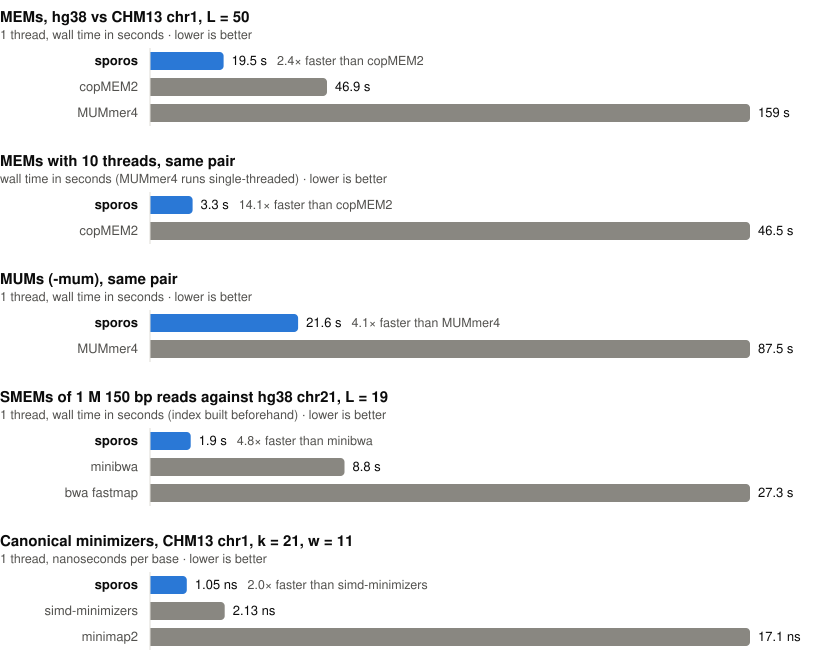

<div align="center">

# sporos

**Fast, exact DNA seeding in [Mojo](https://mojolang.org)**<br>
minimizers · syncmers · seed indexes · MEMs · SMEMs · MUMs

[](https://github.com/kokyriakidis/sporos/actions/workflows/ci.yml)
[](LICENSE)
[](https://mojolang.org)
[](#install)
[](benchmarks/competitors/README.md)

[Quick start](#quick-start) · [What it computes](#what-it-computes) · [Command line](#command-line) ·
[Library](#library) · [C & Python](#c-and-python) · [Benchmarks](#benchmarks) · [How it works](#how-it-works)

</div>

---

sporos finds the seeds that sequence aligners and comparative-genomics tools are built on, as a Mojo library,
a command-line tool, a C library and a Python package.

- ⚡ **Fast.**
  - Minimizers and syncmers run 1.3–2.4x faster than simd-minimizers on one thread.
  - MEMs between hg38 and CHM13 chr1 run 2–2.3x faster than copMEM2 on one thread and 10–14x faster with
    10 threads.
  - MUMs run 4–18x faster than MUMmer.
- 🎯 **Exact.**
  - Every kernel is checked against a brute-force oracle.
  - `sporos mem` reproduces MUMmer's `mummer` output: identical match sets, and `-mum` and `-mumreference`
    identical byte for byte.
  - Results never depend on the thread count.
- 🧰 **Practical.**
  - Reads FASTA and FASTQ (plain, gzip or BGZF) from files or pipes.
  - Multithreaded end to end, with no dependencies beyond the Mojo runtime and libdeflate.

<p align="center">
  <picture>
    <source media="(prefers-color-scheme: dark)" srcset="docs/benchmarks-dark.svg">
    
  </picture>
</p>

## Quick start

```sh
git clone https://github.com/kokyriakidis/sporos && cd sporos
pixi run build-cli                                      # builds build/sporos (pixi fetches Mojo)

build/sporos minimizers -k 21 -w 11 genome.fa           # name<TAB>position, one per minimizer
build/sporos mem -mum -l 50 reference.fa query.fa       # MUMs, in MUMmer's output format
build/sporos seeds -k 19 -w 12 --keep 0.9998 ref.fa reads.fq.gz
```

## What it computes

| | Definition |
|---|---|
| **Minimizers** | For each window of `w` consecutive k-mers, the start of its smallest k-mer under a 32-bit ntHash, ties broken leftmost. Canonical by default (forward and reverse-complement hashes combined). Each position is reported once. |
| **Closed syncmers** | k-mers whose smallest s-mer starts at offset 0 or `k - s`. |
| **Open syncmers** | k-mers whose smallest s-mer starts at a chosen offset `t`, or at any offset of a set. strobealign's default is `k=20, s=16, t=2`. |
| **Seed index** | Reference minimizers, syncmers or all k-mers, keyed by canonical k-mer so lookups find both strands. Hits carry occurrence counts, with an optional abundance cutoff (GraphAligner-style `--keep`). |
| **MEMs** | Every maximal exact match of length ≥ L between a query sequence and the reference (MUMmer's `-maxmatch`). Matches can be any length, up to whole sequences. |
| **SMEMs** | Supermaximal exact matches, as in BWA: query intervals of MEMs (on either strand) that no other MEM's query interval contains, each with every reference position where it matches. The seeds `bwa fastmap` and minibwa find. |
| **MUMs** | MEMs whose string occurs exactly once in the reference and once in the query sequence (MUMmer's `-mum`). `-mumreference` requires uniqueness in the reference only. |

> [!NOTE]
> MEMs and MUMs are **pairwise**, as in MUMmer. The reference can hold many sequences, indexed together, and
> each query record is matched against all of them on the forward strand, the reverse strand or both.
> Multi-genome MUMs, unique in each of N genomes at once as in mumemto or Mumento2, are not supported.

Non-ACGT bases (`N` and other IUPAC codes) never match and break k-mers. Lowercase is accepted, and `U` reads
as `T`. Positions are 0-based everywhere except `sporos mem`, which prints MUMmer's 1-based coordinates.

## Install

sporos builds with [pixi](https://pixi.sh), which fetches the Mojo toolchain (nightly channel) and
libdeflate:

```sh
git clone https://github.com/kokyriakidis/sporos && cd sporos
pixi run build-cli        # the command-line tool: build/sporos
pixi run build-c          # the C library: build/c
pixi run build-python     # the Python package: build/python/sporos
pixi run test             # optional: checks every kernel against its brute-force oracle
```

| Platform | Status |
|---|---|
| Linux x86-64 | tested in CI on every push (AVX2), and on AVX-512 hardware |
| macOS arm64 (Apple silicon) | tested in CI on every push |
| Linux arm64 | configured, untested |

The C and Python builds are self-contained folders that run without pixi or Mojo.

## Command line

```sh
sporos minimizers -k 21 -w 11 -t 8 genome.fa            # name<TAB>position, one line per minimizer
sporos syncmers -k 21 -s 11 genome.fa                   # closed syncmers
sporos syncmers -k 20 -s 16 --open 2 genome.fa          # open syncmers (--open 1,3 for a set)
sporos seeds -k 19 -w 12 --keep 0.9998 ref.fa reads.fq.gz
sporos mem -mum -l 50 -t 8 reference.fa query.fa        # MUMmer's flags and output format
sporos mem -maxmatch -b -l 100 reference.fa query.fa    # all MEMs, both strands
sporos smem -l 19 reference.fa reads.fq                 # SMEMs, in bwa fastmap's output format
```

- **Threads:** every command takes `-t` (default: every physical core).
- **Diagnostics:** `seeds` and `mem` take `-v`, which prints phase timings and peak memory to stderr.
- **Inputs:** any input can be gzipped, BGZF-compressed, or a pipe (`/dev/stdin`).

<details>
<summary><b><code>minimizers</code> and <code>syncmers</code></b>: options and output</summary>

```
sporos minimizers -k K -w W [--forward] [--count] [-t threads] <seqs.fa>
sporos syncmers   -k K -s S [--open T[,T...]] [--forward] [--count] [-t threads] <seqs.fa>
```

| Option | Meaning |
|---|---|
| `-k`, `-w` | k-mer length (1 to 64, default 15) and window length in k-mers (default 10) |
| `-s` | s-mer length for syncmers (`1 ≤ s ≤ k`) |
| `--open T[,T...]` | open syncmers at offset `T`, or at any offset in the list (each in `[0, k - s]` and below 64) |
| `--forward` | forward-strand hashes instead of canonical ones |
| `--count` | print only the totals |

Each output line is `name<TAB>position`, 0-based and increasing within each record. Files with many records,
such as reads, are scanned with one read per SIMD lane.

</details>

<details>
<summary><b><code>seeds</code></b>: seed index and lookups</summary>

```
sporos seeds -k K [-w W | --syncmers -s S [--open T[,T...]] | --all-kmers] [--query-kmers]
             [--max-occ N | --keep F] [-t threads] [-v] <reference.fa> <reads.fa>
```

- **Index:** `seeds` indexes the reference's minimizers by default (k ≤ 32, default k=19, w=12).
- **Lookups:** every read's seeds are looked up, or every read k-mer with `--query-kmers`.
- **Cutoffs:** `--max-occ N` skips seeds that occur more than `N` times in the reference. `--keep F` sets that
  cutoff at the `F` quantile of the indexed k-mers.

Each output line is one hit:

```
read  query_pos  ref_name  ref_pos  strand  occurrences
```

`strand` is `-` when the read k-mer matches the reverse complement of the reference.

</details>

<details>
<summary><b><code>mem</code></b>: MEMs and MUMs, MUMmer-compatible</summary>

```
sporos mem [-mum | -mumreference | -maxmatch] [-l L] [-b | -r] [-F] [-n] [-t threads] [-v]
           [-K anchor_k] [-k1 ref_step] [-k2 query_step] <reference.fa> <query.fa>
```

| Option | Meaning |
|---|---|
| `-maxmatch`, `-mum`, `-mumreference` | all MEMs, MUMs, or MEMs unique in the reference (the default, as in MUMmer) |
| `-l L` | minimum match length (any L ≥ 1, default 20); matches themselves have no upper length limit |
| `-b`, `-r` | both strands, or the reverse complement only (default: forward) |
| `-F` | four-column output, reference name first (always on with several reference sequences) |
| `-n` | accepted for MUMmer compatibility; non-ACGT bases never match anyway |
| `-K`, `-k1`, `-k2` | tuning: anchor length and the coprime reference and query sampling steps (chosen automatically) |

The output follows `mummer`: a `> query` header (`> query Reverse` for the reverse strand), then one
`ref_pos query_pos length` line per match, 1-based.

</details>

<details>
<summary><b><code>smem</code></b>: SMEMs, bwa fastmap-compatible</summary>

```
sporos smem [-l L] [-w W] [-t threads] [-v] <reference.fa> <query.fa>
```

| Option | Meaning |
|---|---|
| `-l L` | minimum SMEM length (default 17, as in `bwa fastmap`) |
| `-w W` | print positions only for SMEMs with at most `W` hits, else `*` (default 20) |

Both strands are searched, as with BWA's index of the reference and its reverse complement. The output is
`bwa fastmap`'s: per query, `SQ name length`, then `EM start end count positions...` (0-based query
interval, positions as `name:+pos` or `name:-pos`, 1-based), then `//`. The SMEMs equal BWA's and minibwa's;
positions are listed in increasing order rather than in suffix-array order.

SMEMs are computed from sporos's MEM engine, which needs no index build: a good fit for comparing genomes.
On short reads with repetitive references, FM-index tools that never enumerate repeat copies (minibwa,
`bwa fastmap`) are currently faster.

</details>

## Library

Put the repository on Mojo's include path (`mojo build -I path/to/sporos ...`):

```mojo
from sporos.fasta import read_fasta
from sporos.mems import MemIndex, MemParams, filter_mums, find_mems
from sporos.minimizers import minimizer_positions
from sporos.syncmers import syncmer_positions
from sporos.text import SeqText


def main() raises:
    var genome = read_fasta("ref.fa", threads=4)  # FASTA/FASTQ, plain, gzip or BGZF
    var seq = genome.seq(0)

    # Seeds: k-mer start positions, increasing.
    var mins = minimizer_positions(seq, k=21, w=11, threads=4)  # canonical by default
    var opened = syncmer_positions(seq, k=20, s=16, open_offset=2)  # open; or open_offsets=[1, 3]

    # MEMs and MUMs of a query against the reference.
    var query = read_fasta("query.fa")
    var refs = List[Span[UInt8, origin_of(genome.data)]]()
    refs.append(seq)
    var qseqs = List[Span[UInt8, origin_of(query.data)]]()
    qseqs.append(query.seq(0))
    var rtext = SeqText(refs)
    var qtext = SeqText(qseqs)
    var index = MemIndex(rtext, MemParams.choose(50, len(rtext), len(qtext)), threads=4)
    var mems = find_mems(index, rtext, qtext, threads=4)  # every MEM of length >= 50
    var mums = filter_mums(mems, qtext, threads=4)  # MUMmer's -mum
    for m in mums:
        print(m.ref_pos, m.query_pos, m.length)
```

<details>
<summary><b>Reads and seed indexes</b>: batches, <code>SeedIndex</code>, lookups</summary>

```mojo
from sporos.batch import minimizers_batch
from sporos.fasta import read_fasta
from sporos.index import MINIMIZER_SEEDS, SeedIndex


def main() raises:
    var genome = read_fasta("ref.fa", threads=4)
    var reads = read_fasta("reads.fq")
    var spans = List[Span[UInt8, origin_of(reads.data)]]()
    for r in range(len(reads)):
        spans.append(reads.seq(r))

    # Many short reads: one read per SIMD lane. batch.seeds(i) is read i's positions.
    var batch = minimizers_batch(spans, k=15, w=10, threads=4)

    # A seed index of the reference, probed with every read's minimizers.
    var refs = List[Span[UInt8, origin_of(genome.data)]]()
    refs.append(genome.seq(0))
    var index = SeedIndex(refs, k=19, w=12, scheme=MINIMIZER_SEEDS, threads=4)
    var hits = index.lookup_batch(spans, max_occurrences=index.occurrence_cutoff(0.9998), threads=4)
    for h in hits.of(0):  # read 0's hits
        print(h.query_pos, h.ref_pos, h.reverse, h.occurrences)
```

Related calls:
- `syncmers_batch` is the batch counterpart for syncmers.
- `SeedIndex.lookup` probes a single read.
- `filter_mums(..., unique_in_query=False)` gives `-mumreference`.

The docstrings in [`sporos/`](sporos) describe every parameter and its limits.

</details>

## C and Python

```sh
pixi run build-c && pixi run build-python
pixi run test-c && pixi run test-python
```

<details open>
<summary><b>Python</b> (<code>PYTHONPATH=build/python</code>, Python ≥ 3.10)</summary>

```python
import sporos

sporos.minimizers(seq, k=21, w=11)                       # array('I') of positions
sporos.syncmers(seq, k=20, s=16, open_offset=2)          # open_offset: None (closed), an int, or a list
index = sporos.Index([ref1, ref2], min_len=50, threads=8)
index.matches(query, mode="mum", reverse=False)          # [(ref_index, ref_pos, query_pos, length), ...]
```

The modes are `"maxmatch"`, `"mum"` and `"mumreference"`. Sequences can be `str` or `bytes`. Invalid
arguments raise `ValueError` or `TypeError`.

</details>

<details>
<summary><b>C</b> (<code>cc -I build/c app.c -L build/c -lsporos -Wl,-rpath,build/c</code>)</summary>

```c
#include "sporos.h"

uint32_t positions[1024];
int64_t n = sporos_minimizers(seq, len, 21, 11, /*canonical*/ 1, /*threads*/ 1, positions, 1024);
// n is the full count even when it exceeds the room given; n <= len always.

const uint8_t *refs[] = {ref};
int64_t lens[] = {ref_len};
sporos_index *index = sporos_index_new(refs, lens, 1, /*min_len*/ 50, /*threads, 0 = all cores*/ 0);
sporos_matches *mums = sporos_index_matches(index, query, query_len, SPOROS_MUM, /*reverse*/ 0, 0);
const sporos_match *m = sporos_matches_data(mums);  // ref_seq, ref_pos, query_pos, length
for (int64_t i = 0; i < sporos_matches_count(mums); i++) { /* ... */ }
sporos_matches_free(mums);
sporos_index_free(index);
```

- The API also has `sporos_syncmers` (closed, or open at one offset) and `sporos_syncmers_open` (open at a set
  of offsets).
- Invalid arguments return `SPOROS_INVALID_ARGUMENT` or `NULL`.
- The full API is in [`c/sporos.h`](c/sporos.h).

</details>

## Benchmarks

**Setup:**
- **Machine:** Intel i9-7900X (Skylake-X, AVX-512, 10 cores, turbo off).
- **Settings:** each tool runs with its best settings.
- **Timing:** best wall time, including reading input and writing output.

The full method, competitor versions and correctness checks are in
[`benchmarks/competitors`](benchmarks/competitors/README.md); all 60 match sets equal MUMmer's and copMEM2's.
Competitor rows come from that suite; sporos rows are from the current code.

<details>
<summary><b>All results</b></summary>

| MEMs (1 / 10 threads) | sporos | copMEM2 `-mf` | MUMmer4 (1 thread) |
|---|---|---|---|
| hg38 vs CHM13 chr1, L=100 | **5.8 s / 1.1 s** | 11.4 s / 11.1 s | 132 s |
| hg38 vs CHM13 chr1, L=50 (65.6 M MEMs) | **20.7 s / 3.4 s** | 46.9 s / 46.5 s | 159 s |
| hg38 vs chimp chr21, L=50 | **0.78 s / 0.22 s** | 1.96 s / 1.95 s | 17.4 s |

| MUMs, `-mum` | sporos (1 / 10 threads) | MUMmer4 (1 thread) |
|---|---|---|
| hg38 vs CHM13 chr1, L=100 | **6.1 s / 1.2 s** | 93.8 s |
| hg38 vs CHM13 chr1, L=50 | **23.3 s / 4.4 s** | 87.5 s |
| hg38 vs chimp chr21, L=50 | **0.81 s / 0.24 s** | 14.6 s |

| Seeds, CHM13 chr1, ns/bp (forward / canonical) | sporos | simd-minimizers 3.0 | minimap2 `mm_sketch` |
|---|---|---|---|
| minimizers k=21 w=11, 1 thread | **1.18 / 1.11** | 1.81 / 2.17 | — / 17.1 |
| minimizers k=31 w=19, 1 thread | **1.04 / 0.98** | 1.64 / 1.93 | |
| closed syncmers k=31 s=21, 1 thread | **1.09 / 1.25** | 2.00 / 2.58 | |
| minimizers k=21 w=11, 10 threads | **0.17 / 0.18** | 0.19 / 0.20 | — / 1.96 |
| minimizers k=31 w=19, 10 threads | **0.13 / 0.13** | 0.16 / 0.19 | |
| closed syncmers k=31 s=21, 10 threads | **0.17 / 0.18** | 0.20 / 0.25 | |

- **Seed-index lookups** (hg38 chr21 index, k=19, w=12, occurrence cap 20, simulated 150 bp reads):
  - read minimizers: 137 Mbp/s per thread, 560 Mbp/s on 8 threads;
  - every read k-mer: 36 Mbp/s per thread.
- **End to end**, including reading input and writing every line:
  - `sporos minimizers -k 21 -w 11` on CHM13 chr1 (41 M lines): 0.94 s on one thread, 0.26 s on ten;
  - `sporos seeds` on 1 M reads (27 M hit lines, index build included): 2.4 s on one thread, 0.61 s on ten.
- **Peak memory** for MEMs on chr1 is 1.2 GB at L=100 and 2.4–2.6 GB at L=50; copMEM2 `-mf` uses 1.7 GB.

**Caveats:**
- With 10 threads, sporos returns one merged list of positions, while simd-minimizers' harness only counts
  each thread's positions.
- MUMmer 4.0.1 and copMEM2 gain nothing from threads on a single query record.

</details>

## How it works

<details>
<summary><b>Seeds, MEMs, MUMs, the seed index and input</b></summary>

- **Seed kernel** (`sporos/window.mojo`).
  - One engine serves minimizers and syncmers. A sequence splits into 8 SIMD lanes (16 with AVX-512), each
    rolling a 32-bit ntHash.
  - A byte transpose feeds the lanes and precomputes seed-table indices, so each hash update is one byte
    shuffle (NEON `tbl` or x86 `pshufb`).
  - The sliding-window minimum uses prefix/suffix blocks with single u32 keys, which keeps leftmost
    tie-breaking exact. Deduplication is fused into the loop.
  - Batches give each read its own lane.
  - Threads take small segments in order and copy their positions once into the final list, after the
    previous segment publishes where it ends.
- **MEMs** (`sporos/mems.mojo`, `sporos/table.mojo`).
  - Matches are located through short anchors (K ≤ 32 bases): reference K-mers every `k1` bases, and query
    K-mers every `k2` bases, with `k1` and `k2` coprime and `k1 · k2 ≤ L - K + 1`. Each anchor hit is then
    extended in both directions, 32 bases per compare, as far as the match goes.
  - Anchors of one MEM sit `k1 · k2` apart on its diagonal, so the anchor whose match does not reach that far
    to the left reports it: each MEM is found exactly once, with no deduplication pass.
  - The hash table is built by a parallel two-level radix sort, with about four anchors per bucket.
  - Probes stream through a software pipeline: hash, bucket bounds, a vector fingerprint compare, then a
    prefetch of the candidate's reference text before extension.
  - Matches are radix-sorted per query chunk.
- **MUMs.** A MEM is a MUM unless another MEM of the same query contains it in reference or query
  coordinates. Both checks are linear sweeps, parallelized by blocks, after a parallel radix sort by
  reference start.
- **Seed index** (`sporos/index.mojo`).
  - Canonical k-mers are hashed by a bijection on 2k bits. Bucket and fingerprint therefore identify a k-mer
    exactly whenever their bits suffice; otherwise candidates are checked against the text.
  - Batched lookups stream every read through one prefetch pipeline.
- **Input** (`sporos/fasta.mojo`).
  - FASTA is parsed in place.
  - BGZF inflates block by block in parallel with libdeflate.
  - Plain gzip goes through libdeflate, with zlib as a fallback.
- **Threads** come from a small pthreads `parallel_for` (`sporos/parallel.mojo`).

</details>

## Limits

- Each sequence, and the concatenated reference, must be shorter than 2^32 bases.
- MEMs and MUMs can be any length up to that. The minimum length `L` can be any value of at least 1.
- Minimizer and syncmer k-mers are at most 64 bases, and seed-index k-mers at most 32.
- Open-syncmer offsets must be below 64.
- The benchmarks above are from x86-64 Linux. Apple-silicon performance has not been re-measured since the
  latest optimizations.

## Development

| Task | What it does |
|---|---|
| `pixi run test` | builds and runs the Mojo test suites (oracles in `tests/reference.mojo`) |
| `pixi run test-c`, `pixi run test-python` | builds the bindings and checks them against the library's outputs |
| `pixi run test-cli` | checks every command across thread counts, gzip and piped input, and known answers |
| `pixi run bench-seeds`, `bench-reads`, `bench-index` | measures seed kernel, read batch and seed-index throughput |
| `pixi run format` | formats the sources (120 columns) |
| `python3 scripts/benchmark_chart.py` | redraws the chart above from its numbers |
| `bash benchmarks/competitors/run_*.sh` | runs the competitor suite (see its README) |

Pass `-D SPOROS_LANES=8` to `mojo build` to force AVX2-width lanes. Coding agents should read
[`CLAUDE.md`](CLAUDE.md): the Modular Mojo skills are vendored in `.claude/skills` and take precedence over
pretrained Mojo habits.

## License

[MIT](LICENSE) © Konstantinos Kyriakidis
